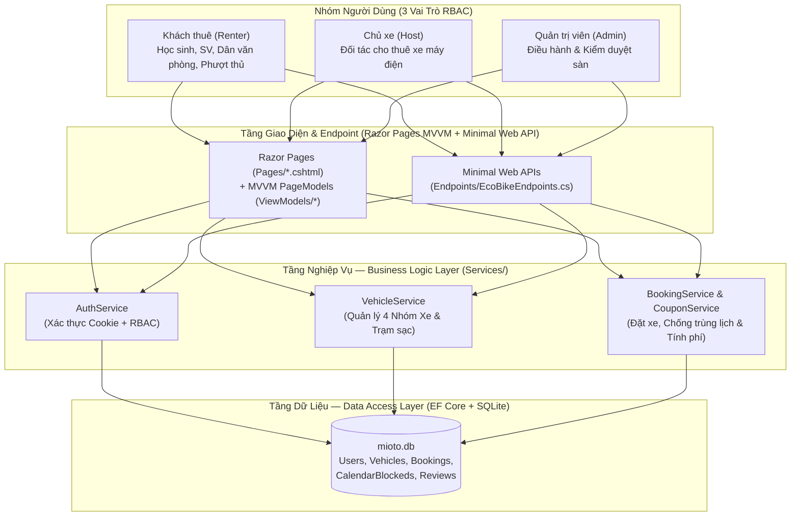
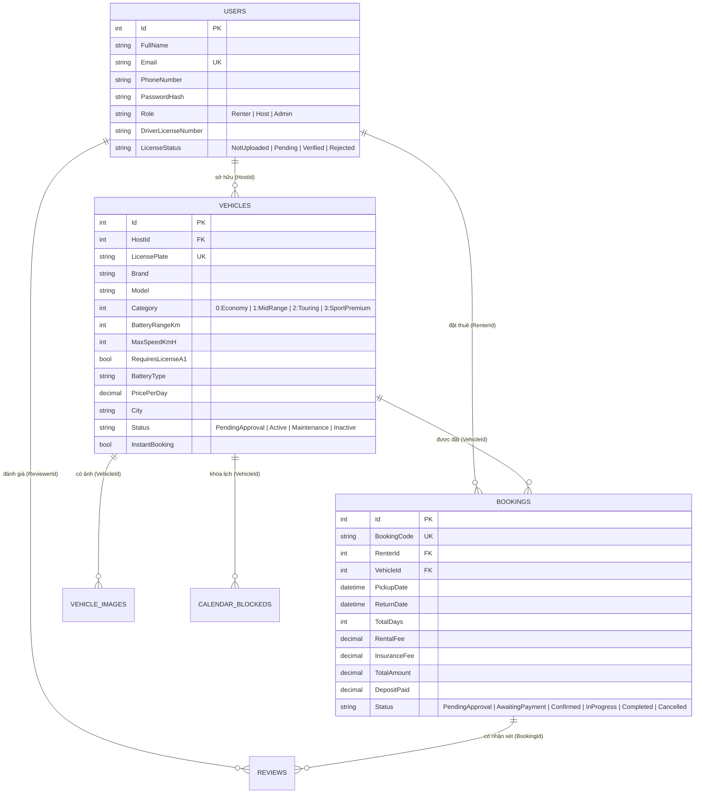

# TÀI LIỆU ĐẶC TẢ YÊU CẦU PHẦN MỀM (SRS)
## DỰ ÁN: HỆ THỐNG CHO THUÊ VÀ CHIA SẺ XE MÁY ĐIỆN THÔNG MINH (ECOBIKE PLATFORM)

| Thông tin tài liệu | Chi tiết |
| :--- | :--- |
| **Tên dự án** | Nền tảng Cho thuê và Chia sẻ Xe máy điện Thông minh (EcoBike) |
| **Mã dự án** | ECOBIKE-MVVM-2026 |
| **Phiên bản** | 2.1 (Phiên bản chính thức — Kiến trúc 3-Layer + Razor Pages MVVM & Minimal Web API) |
| **Ngày cập nhật** | 13/10/2026 |
| **Thành viên thực hiện** | Trần Nhất Tâm (BE/FE), Đặng Sỹ Phố (FE/BE), Nguyễn Phương Nam (BA/QA & Báo cáo) |
| **Công nghệ triển khai** | C# (.NET 9), ASP.NET Core Razor Pages (MVVM `PageModel`), Minimal Web API, 3-Layer Services, EF Core, SQLite, Tailwind CSS, xUnit |
| **Kho mã nguồn (GitHub)** | `https://github.com/tam024212-star/MiotoCarRental.git` |

---

## 1. GIỚI THIỆU TỔNG QUAN (INTRODUCTION)

### 1.1. Mục đích tài liệu
Tài liệu Đặc tả Yêu cầu Phần mềm (*Software Requirements Specification - SRS*) này mô tả đầy đủ các yêu cầu nghiệp vụ, kiến trúc phần mềm phi-MVC (**3-Layer Service Architecture kết hợp Razor Pages MVVM & Minimal Web API**), yêu cầu chức năng (Functional Requirements), yêu cầu phi chức năng (Non-Functional Requirements), thiết kế cơ sở dữ liệu và kịch bản kiểm thử của hệ thống **EcoBike**. Tài liệu là cơ sở chuẩn mực để nhóm phát triển, giảng viên hướng dẫn và trợ giáo đối chiếu, nghiệm thu chất lượng sản phẩm.

### 1.2. Phạm vi dự án (Project Scope)
**EcoBike** là nền tảng thương mại điện tử hai chiều (Two-Sided P2P Marketplace) chuyên biệt cho lĩnh vực **cho thuê xe máy điện thông minh** tại các đô thị lớn (TP. Hồ Chí Minh, Hà Nội, Đà Nẵng), kết nối trực tiếp 3 nhóm đối tượng:
* **Khách thuê (Renter):** Tra cứu xe máy điện theo 4 nhóm nhu cầu (đặc biệt có dòng xe phổ thông dưới 50km/h không yêu cầu bằng lái A1 dành cho học sinh, sinh viên), lọc theo cự ly pin LFP, đặt xe trực tuyến, ký hợp đồng điện tử và tra cứu trạm sạc/đổi pin 24/7.
* **Chủ xe (Host):** Đăng ký phương tiện nhàn rỗi lên sàn (hỗ trợ công cụ điền mẫu thông số tự động), quản lý lịch cho thuê, duyệt đơn đặt xe, bàn giao xe (ghi nhận % pin, ODO) và theo dõi doanh thu.
* **Quản trị viên (Admin):** Kiểm duyệt giấy phép lái xe (GPLX A1), phê duyệt phương tiện mới của chủ xe, giám sát toàn bộ đơn đặt xe, quản lý người dùng và thống kê doanh thu sàn.

### 1.3. Định nghĩa thuật ngữ và từ viết tắt
| Thuật ngữ / Từ viết tắt | Giải thích chi tiết |
| :--- | :--- |
| **SRS** | Software Requirements Specification – Tài liệu đặc tả yêu cầu phần mềm |
| **MVVM (`PageModel`)** | Model-View-ViewModel – Mô hình kiến trúc giao diện trên ASP.NET Core Razor Pages thay thế hoàn toàn mô hình MVC truyền thống |
| **Minimal Web API** | Kiến trúc định tuyến API gọn nhẹ trên .NET 9 (`IEndpointRouteBuilder`) không sử dụng `Controller` |
| **3-Layer Architecture** | Kiến trúc 3 tầng tách biệt: Presentation Layer (`Pages/`), Business Logic Layer (`Services/`), Data Access Layer (`Data/`) |
| **P2P** | Peer-to-Peer – Mô hình kết nối chia sẻ tài sản ngang hàng giữa Chủ xe và Khách thuê |
| **RBAC** | Role-Based Access Control – Cơ chế phân quyền truy cập theo vai trò (`Renter`, `Host`, `Admin`) |
| **Pin LFP** | Lithium Iron Phosphate – Công nghệ pin xe điện chống cháy nổ, tuổi thọ cao, đi được 180–270 km/sạc |
| **GPLX A1** | Giấy phép lái xe hạng A1 (Miễn yêu cầu đối với nhóm xe phổ thông vận tốc tối đa < 50 km/h) |
| **Instant Booking** | Chế độ Đặt xe nhanh – Khách đặt được xác nhận tự động không cần chờ chủ xe duyệt thủ công |

---

## 2. MÔ TẢ TỔNG THỂ HỆ THỐNG (OVERALL DESCRIPTION)

### 2.1. Sơ đồ ngữ cảnh và Kiến trúc hệ thống (Non-MVC: 3-Layer + Razor Pages MVVM + Minimal API)

Hệ thống được thiết kế tuân thủ yêu cầu **không sử dụng ASP.NET Core MVC (`Controllers/` & `Views/`)**, thay vào đó tổ chức thành các tầng độc lập:

### 2.2. Phân quyền người dùng (Role-Based Access Control - RBAC)

| Vai trò | Quyền hạn truy cập | Tài khoản kiểm thử (Seed Data) |
| :--- | :--- | :--- |
| **Khách vãng lai (`Guest`)** | Xem Trang chủ (`/`), xem danh sách xe theo 4 nhóm (`/Vehicles`), xem chi tiết xe (`/Vehicles/Details/{id}`), xem mạng lưới trạm sạc & đổi pin (`/Stations`). | Không cần đăng nhập |
| **Khách thuê (`Renter`)** | Toàn bộ quyền của Guest + Đặt thuê xe, xem lịch sử chuyến thuê (`/Bookings/MyBookings`), xem hợp đồng điện tử (`/Bookings/Contract/{id}`), đánh giá sao, cập nhật GPLX (`/Account/Profile`), nâng cấp lên Chủ xe. | `khachthue@gmail.com` / `renter123` |
| **Chủ xe (`Host`)** | Toàn bộ quyền của Renter + Truy cập **Kênh Chủ Xe** (`/Host`), đăng xe máy điện mới (`/Host/Create`), duyệt yêu cầu thuê, xác nhận bàn giao & hoàn thành chuyến đi. | `chuxe@gmail.com` / `host123` |
| **Quản trị sàn (`Admin`)** | Toàn quyền hệ thống + Truy cập **Quản trị sàn** (`/Admin`), phê duyệt/từ chối GPLX người dùng, khóa xe, giám sát dữ liệu toàn sàn. | `admin@mioto.vn` / `admin123` |

### 2.3. Phân loại 4 nhóm phương tiện xe máy điện (`VehicleCategory`)

Hệ thống chuẩn hóa danh mục phương tiện thành **04 phân khúc nhu cầu** rõ rệt:

| Mã Enum | Tên phân khúc | Đặc tả kỹ thuật & Đối tượng mục tiêu | Yêu cầu GPLX A1 | Khoảng giá thuê / ngày | Mẫu xe tiêu biểu trong hệ thống |
| :--- | :--- | :--- | :---: | :---: | :--- |
| `Economy` (0) | **Phổ thông & Học sinh/SV** | Vận tốc giới hạn $\le 49$ km/h, gọn nhẹ, dễ điều khiển, phù hợp học sinh, sinh viên đi học. | **Miễn bằng A1** (`false`) | 70.000đ – 85.000đ | VinFast Evo200 Lite, Yadea Ocean, Pega Aura S, Yadea Voltguard |
| `MidRange` (1) | **Đô thị & Đi làm** | Vận tốc 70–80 km/h, cốp rộng 21–25L, pin 150–203 km/sạc, dành cho nhân viên văn phòng. | Cần bằng A1 (`true`) | 100.000đ – 120.000đ | VinFast Feliz S, VinFast Evo200, Selex Camel |
| `Touring` (2) | **Đường dài & Phượt** | Pin dung lượng cao 200–270 km/sạc, khung gầm đầm chắc, cốp tới 41L cho chuyến đi xa. | Cần bằng A1 (`true`) | 130.000đ – 180.000đ | Dat Bike Quantum, VinFast Klara S (2024) |
| `SportPremium` (3) | **Thể thao & Cao cấp** | Động cơ 6000W–7100W, tốc độ 90–100 km/h, phanh ABS 2 kênh, cảm biến thông minh. | Cần bằng A1 (`true`) | 180.000đ – 250.000đ | VinFast Vento S, Dat Bike Weaver++, VinFast Theon S |

---

## 3. ĐẶC TẢ YÊU CẦU CHỨC NĂNG (FUNCTIONAL REQUIREMENTS)

### 3.1. Module 1: Quản lý Tài khoản, Xác thực & Phân quyền (`Pages/Account/` & `AuthService`)

| Mã YC | Tên chức năng | Mô tả chi tiết nghiệp vụ | Độ ưu tiên |
| :--- | :--- | :--- | :---: |
| **FR-01** | Đăng ký tài khoản (`RegisterViewModel`) | Cho phép người dùng tạo tài khoản mới tại `/Account/Register` với Họ tên, Email, Số điện thoại và Mật khẩu. Tài khoản mới luôn bắt đầu ở vai trò Renter; kiểm tra trùng Email và Số điện thoại. | Cao |
| **FR-02** | Đăng nhập & tài khoản demo (`LoginViewModel`) | Xác thực thông tin đăng nhập tại `/Account/Login`, khởi tạo phiên Cookie chứa Claims (`NameIdentifier`, `Name`, `Email`, `Role`, `DriverLicenseStatus`). QuickLogin chỉ có trong Development, bị giới hạn ở tài khoản demo và vẫn yêu cầu mật khẩu hợp lệ. | Cao |
| **FR-03** | Quản lý Hồ sơ & Xác thực GPLX (`ProfileViewModel`) | Cho phép người dùng cập nhật số GPLX A1 tại `/Account/Profile`. Khi cập nhật mới, trạng thái chuyển về `Pending` chờ Admin duyệt. | Trung bình |
| **FR-04** | Nâng cấp tài khoản lên Chủ xe (`BecomeHostPageModel`) | Khách thuê (`Renter`) có thể đăng ký trở thành Chủ xe tại `/Host/BecomeHost`, hệ thống nâng cấp quyền lên `Host` và làm mới phiên đăng nhập ngay lập tức. | Trung bình |
| **FR-05** | Kiểm soát truy cập (`AccessDeniedPageModel`) | Tự động chặn và chuyển hướng tới `/Account/AccessDenied` khi người dùng truy cập trái phép vào các Razor Pages của `Host` hoặc `Admin`. | Cao |

### 3.2. Module 2: Tìm kiếm, Phân loại Xe & Trạm sạc (`Pages/Vehicles/`, `VehicleService`)

| Mã YC | Tên chức năng | Mô tả chi tiết nghiệp vụ | Độ ưu tiên |
| :--- | :--- | :--- | :---: |
| **FR-06** | Trang chủ & Khám phá nhanh (`HomeIndexPageModel`) | Hiển thị thanh tìm kiếm nhanh theo Thành phố + Phân khúc xe, 4 thẻ phân khúc xe điện, danh sách xe nổi bật và quy trình thuê xe thông minh. | Cao |
| **FR-07** | Lọc xe theo 4 nhóm phân khúc (`VehicleListViewModel`) | Hỗ trợ thanh lọc chuyển đổi 1 chạm giữa *Tất cả xe*, *Phổ thông (Miễn bằng A1)*, *Đô thị*, *Đường dài*, *Thể thao* trên trang `/Vehicles`. | Cao |
| **FR-08** | Bộ lọc đa tiêu chí & REST API | Lọc kết hợp theo Thành phố, Hãng xe, Quy định bằng lái A1, Quãng đường pin tối thiểu, Mức giá tối đa. Cung cấp thêm Minimal API `/api/vehicles` trả dữ liệu JSON. | Cao |
| **FR-09** | Xem chi tiết thông số xe (`VehicleDetailViewModel`) | Trang `/Vehicles/Details/{id}` hiển thị hình ảnh, phân khúc, giá thuê/ngày, 4 thông số kỹ thuật cốt lõi (Cự ly pin, Tốc độ tối đa, Yêu cầu GPLX, Định mức km/ngày) và đánh giá từ khách thuê. | Cao |
| **FR-10** | Tra cứu Trạm sạc & Đổi pin (`Pages/Stations.cshtml`) | Trang `/Stations` hiển thị danh sách trạm sạc V-GREEN, Dat Bike Station và tủ đổi pin tự động 24/7 trên bản đồ trực quan. | Trung bình |

### 3.3. Module 3: Đặt xe, Tính phí, Hợp đồng & Đánh giá (`Pages/Bookings/` & `BookingService`)

| Mã YC | Tên chức năng | Mô tả chi tiết nghiệp vụ | Độ ưu tiên |
| :--- | :--- | :--- | :---: |
| **FR-11** | Kiểm tra điều kiện bằng lái A1 | Nếu xe có `RequiresLicenseA1 = true`, hệ thống kiểm tra khách thuê phải có GPLX hợp lệ. Nếu xe thuộc nhóm học sinh (`RequiresLicenseA1 = false`), cho phép đặt ngay không cần bằng A1. | Cao |
| **FR-12** | Chống đặt trùng lịch (Anti-Double Booking) | Tầng `BookingService` kiểm tra xung đột thời gian `(StartTime < existing.EndTime && EndTime > existing.StartTime)` trên cả bảng `Bookings` và `CalendarBlockeds`. | Cao |
| **FR-13** | Tính toán chi phí & Mã giảm giá (`CouponService`) | Công thức: `RentalFee = Số ngày × Giá/ngày`; `InsuranceFee = Số ngày × 20.000đ`; áp dụng mã giảm giá (`DiscountCoupon`); tính tiền cọc thế chấp (`SecurityDeposit`). | Cao |
| **FR-14** | Khởi tạo đơn & Khóa lịch xe | Nếu xe bật `InstantBooking`, đơn chuyển sang trạng thái chờ thanh toán cọc (`AwaitingPayment`) và sau khi xác nhận thanh toán (`/Bookings/ConfirmPayment`) chuyển sang `Confirmed`. | Cao |
| **FR-15** | Hợp đồng thuê xe điện tử (`Pages/Bookings/Contract.cshtml`) | Xuất hợp đồng điện tử (`/Bookings/Contract/{id}`) gồm đầy đủ thông tin Bên A (Chủ xe), Bên B (Khách thuê), thông số xe, bảng kê chi phí và điều khoản pháp lý, hỗ trợ in/xuất PDF. | Trung bình |
| **FR-16** | Biên bản Bàn giao (Check-in/Check-out) & Đánh giá | Ghi nhận ODO và % Pin lúc nhận xe (`/Bookings/Checkin`) và trả xe (`/Bookings/Checkout`), tự động tính phụ phí vượt km/hụt pin và cho phép chấm điểm 1–5 sao (`/Bookings/AddReview`). | Trung bình |

### 3.4. Module 4: Kênh Đối tác Chủ xe (`Pages/Host/` & `HostDashboardViewModel`)

| Mã YC | Tên chức năng | Mô tả chi tiết nghiệp vụ | Độ ưu tiên |
| :--- | :--- | :--- | :---: |
| **FR-17** | Dashboard Chủ xe (`HostDashboardViewModel`) | Trang `/Host` thống kê tổng số xe đang sở hữu, số đơn đang hoạt động và tổng doanh thu từ các chuyến thuê. | Cao |
| **FR-18** | Đăng xe mới kèm Gợi ý tự động (`CreateVehicleViewModel`) | Trang `/Host/Create` cung cấp form đăng ký xe mới đầy đủ phân loại `Category`, thông số pin, tốc độ, biển số, giá thuê và 4 nút điền tự động thông số mẫu. | Cao |
| **FR-19** | Duyệt yêu cầu thuê & Đổi trạng thái xe | Chủ xe xác nhận đơn đặt xe (`/Host/ApproveBooking`) hoặc bật/tắt trạng thái sẵn sàng cho thuê của xe (`/Host/ToggleStatus`). | Cao |

### 3.5. Module 5: Kênh Quản trị sàn (`Pages/Admin/` & `AdminDashboardViewModel`)

| Mã YC | Tên chức năng | Mô tả chi tiết nghiệp vụ | Độ ưu tiên |
| :--- | :--- | :--- | :---: |
| **FR-21** | Dashboard Thống kê toàn sàn (`AdminDashboardViewModel`) | Trang `/Admin` hiển thị các chỉ số nội bộ như doanh thu mô phỏng, số chuyến, danh sách người dùng và phương tiện; API công khai không trả dữ liệu GMV hay hoa hồng. | Cao |
| **FR-22** | Phê duyệt / Từ chối GPLX | Admin kiểm tra thông tin GPLX A1 của người dùng và bấm Duyệt (`/Admin/ApproveLicense`) hoặc Từ chối (`/Admin/RejectLicense`). | Cao |
| **FR-23** | Kiểm duyệt phương tiện & Quản lý User | Admin duyệt/tạm khóa xe (`/Admin/ToggleVehicleStatus`), hủy đơn vi phạm (`/Admin/CancelBooking`) và phân quyền người dùng (`/Admin/UpdateUserRole`). | Trung bình |

---

## 4. THIẾT KẾ CƠ SỞ DỮ LIỆU (DATABASE SCHEMA)

Hệ thống sử dụng **Entity Framework Core 9.0** với hệ quản trị CSDL **SQLite** (`mioto.db`):

---

## 5. YÊU CẦU PHI CHỨC NĂNG & KIỂM ĐỊNH CHẤT LƯỢNG (NFR & QA)

### 5.1. Yêu cầu phi chức năng (Non-Functional Requirements)
1. **Kiến trúc Phần mềm Phi-MVC (Non-MVC Architecture):**
   * Loại bỏ hoàn toàn sự phụ thuộc vào `Controllers` và `Views` của mô hình MVC cũ.
   * Sử dụng **Razor Pages MVVM (`PageModel`)** cho tầng giao diện, **Minimal Web API (`Endpoints`)** cho tầng giao tiếp HTTP/JSON và **3-Layer Services (`Services/`)** cho tầng nghiệp vụ.
2. **Bảo mật & Phân quyền:**
   * Sử dụng Cookie-based Authentication của ASP.NET Core kết hợp thuộc tính `[Authorize(Roles = "...")]` trực tiếp trên các lớp `PageModel` và kiểm tra quyền tại các Minimal API Endpoints.
3. **Hiệu năng & Khởi tạo tự động:**
   * Trong Development, khi `Database:SeedDemoData=true`, có thể khởi tạo schema và nạp **12 mẫu xe máy điện** thuộc 4 nhóm phân khúc cùng **03 tài khoản phân quyền mẫu**. Production không tự seed database.

### 5.2. Tổng hợp Kết quả Kiểm thử Tự động (Unit Testing - xUnit)
Dự án hiện đi kèm bộ kiểm thử tự động `MiotoCarRental.Tests` gồm **5 test cases** chạy trên SQLite in-memory cô lập:
* Kiểm tra xác thực và nâng cấp mật khẩu plaintext cũ.
* Kiểm tra hash mật khẩu mới và từ chối mật khẩu sai.
* Kiểm tra đăng ký không thể tự cấp vai trò Admin.
* Kiểm tra chống đặt trùng lịch và các chuyển trạng thái check-in/check-out.
* Kiểm tra người dùng không liên quan không thể xem chi tiết booking.
